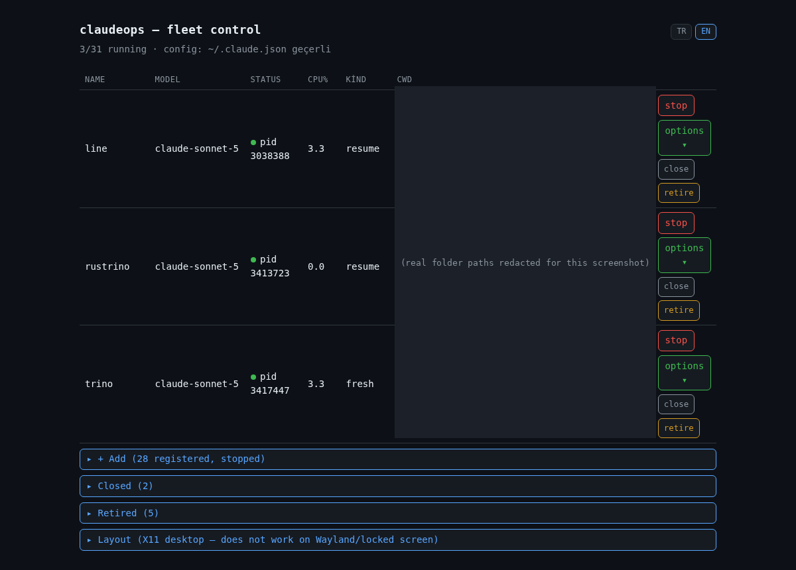
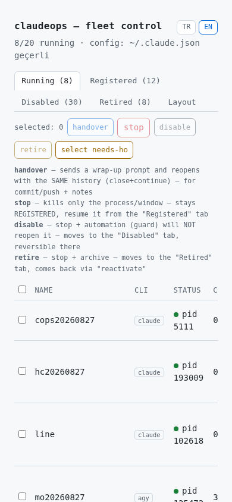

# claudeops — Python (`py/cops`)

*[English](README.md) · Türkçe*

Birden fazla proje klasöründe, birden fazla AI kodlama-ajanı CLI oturumunu — Claude Code, Codex,
Copilot CLI, agy (Antigravity), ya da düz bir shell — tek yerden yönetmek için küçük bir CLI + yerel
web paneli. Her proje bir "roster" satırı (isim → klasör → model); `py/cops web` bu roster'ı gösterip
tek tek başlatma/durdurma sağlar. Pluggable: başka bir CLI backend'i eklemek bir provider dosyası
daha yazmak demek, yeniden yazım değil (bkz. aşağıdaki "Nasıl çalışır").

Linux + X11 gerekir (`gnome-terminal`'e bağımlı) — WSL/headless/macOS/Windows desteklenmiyor.

## Kurulum

```bash
git clone https://github.com/mfyuce/claudeops.git
cd claudeops
pip install -r py/requirements.txt   # tek bağımlılık: psutil
```

Python 3.10+. `claude` CLI kurulu ve PATH'te olmalı (varsayılan backend budur). Diğer backend'ler —
`agy`, `codex`, `copilot`, ya da düz bir `shell` — tamamen opsiyonel, session başına seçilir (bkz.
aşağıdaki "CLI seçimi").

## Hızlı başlangıç

```bash
py/cops list          # şu an çalışan session'ları göster
py/cops web            # kontrol paneli → http://127.0.0.1:8765
py/cops web --tunnel   # + telefondan/uzaktan erişim (cloudflared, ilk seferde otomatik kurulur)
```

## `py/cops web` — kontrol paneli

En kolay kullanım yolu; her şey tarayıcıdan:



- **Sekmeler** — **Çalışanlar / Kayıtlı / Devre dışı / Emekli / Layout / Tanı / Uzak Masaüstü / Ayarlar** (aktif
  sekme sayfa yenilense de hatırlanır). Hiçbir şey otomatik açılmaz — Uzak Masaüstü sekmesinin daemon'ı
  da dahil, aşağıya bakın.
- **Çalışanlar** — tüm canlı session'lar, her satırda **checkbox**, tablonun üstünde **toplu işlem
  butonları**: *handover* / *durdur* / *devre dışı bırak* / *emekli et* seçili satırlara sırayla
  uygulanır — onay diyaloğu isimleri listeler, ilerleme ve hatalar satır satır raporlanır. Butonların
  altındaki kısa açıklama (legend) her işlemin ne yaptığını söyler. **ho? kolonu** session'ın
  *handover'a ihtiyacı var mı* gösterir (repo kirli / untracked dosya / baseline'dan beri commit /
  wrap-up yok), **needs-ho seç** butonu hepsini tek tıkla seçer.
- **durdur vs devre dışı vs emekli** — *durdur* sadece process/pencereyi kapatır (proje kayıtlı kalır —
  Kayıtlı sekmesinden devam ettirilir); *devre dışı bırak* ek olarak otomasyonun (guard) yeniden
  açmasını engeller (Devre dışı sekmesine taşınır, geri alınabilir); *emekli et* arşive kaldırır
  (Emekli sekmesi, "tekrar işe al" ile döner).
- **Terminal** — `tmux` ile açılmış (`-L cops`, ayrı bir socket) satırlarda **Terminal** butonu belirir:
  tarayıcıdan canlı çıktıyı izle + komut gönder (xterm.js render, ~200ms poll, artı Ctrl-C/Esc/ok tuşu
  butonları). `tmux` gerekir (`sudo apt install tmux`) — kurulu değilse session'lar yine sorunsuz açılır,
  sadece buton görünmez. Sadece tmux desteği eklendikten SONRA (yeniden) açılan session'lar bu butonu
  kazanır; hâlâ çalışan düz bir session bir sonraki respawn'da (handover/devral/durdur+başlat) kazanır.
  Gördüğünüz tmux'un kendi scrollback'i, CLI'ın kendi ekran çizimi değil — gerçek bir terminal
  penceresinde kaydırmaya göre biraz kayma normal (bilinen ince kusur, iyileştiriliyor), ama session her
  iki durumda da tamamen ulaşılabilir ve yönlendirilebilir kalır. Bu aynı zamanda bu butonu **her**
  CLI backend için çalıştıran şey — kendi uzaktan-erişim özelliği olmayan biri (agy'de yok) için bile —
  session'ı ulaşılabilir kılan claudeops'un kendi tmux katmanı, alttaki CLI'nın bunu desteklemesi gerekmiyor.
  **Aynı zamanda tepki vermeyen bir session'a bakma/müdahale etme yolu** — bir Claude (ya da agy/codex)
  session'ı kendi arayüzünde tepkisiz kalırsa (takıldı, rate-limit'e girdi, hiç görmediğiniz bir izin
  isteğinde bekliyor), buradan Terminal'i aç: pane'in gerçek canlı halini gösterir (session'ın kendi
  arayüzünde ne bozuksa ondan bağımsız) ve aynı ekrandan ona komut gönderebilir ya da yeniden
  başlatabilirsiniz.
  İki yazma yolu var: alttaki komut kutusu mesajın tamamını tek seferde gönderir (Enter yollar,
  Shift+Enter yeni satır — çok satırlı promptlar CLI'a TEK bir tur olarak ulaşır), ya da **canlı
  yazma**yı açıp terminalin kendisine tıklayarak tuş tuş yazarsınız (ok tuşları, ctrl-c ve Enter dahil)
  — gerçek bir terminal penceresindeki gibi. Canlı yazma varsayılan olarak kapalıdır (açıkken okurken
  kazara basılan bir tuş çalışan CLI'a gider) ve tercih tarayıcıda hatırlanır.
- **Kayıtlı** — kayıtlı-ama-durmuş projeler; **devam ettir** / **sıfırla (--new)** / **ayrı yeni chat
  aç** (otomatik tarih-isimli, model/permission-mode/effort seçenekli) ile başlatırsınız. **Yeni proje
  kaydet** formu (isim + klasör + model) bu sekmenin altında — elle dosya düzenlemeden roster'a ekler.
- **CLI seçimi (claude / agy / codex / copilot / shell)** — her başlat/kaydet/yeni-chat seçenek
  satırında bir **CLI** seçici var: session başına backend seçilir. Model/permission-mode/effort
  seçenekleri seçili CLI'ya göre otomatik değişir (ör. agy'nin model listesi `agy models`'tan CANLI
  çekilir, sabit kodlanmaz). Bir session'ın CLI'ı çalışırken SABİTTİR — küçük bir rozet olarak
  gösterilir, değiştirilemez (yabancı bir proc'u devralmak onun zaten hangi CLI olduğunu korur —
  "bir claude proc'unu agy olarak devral" diye bir şey yok). claudeops'un isim vermediği bare bir proc
  `<cli>-<pid>` olarak görünür (ör. `agy-<pid>`), diğer kayıtsız session'lar gibi devralınabilir. Bugün
  bu beşi hazır; arkasındaki provider mimarisi (aşağıda "Nasıl çalışır") başka bir CLI-tabanlı kodlama
  ajanı eklemeyi bir provider dosyası daha yazmak haline getiriyor, yeniden yazım değil.
- **Devre dışı / Emekli** — geçici durdurulmuş / tamamen bırakılmış projeler; "tekrar işe al"la geri gelir.
- **Handover** — seçili çalışan session'lara wrap-up mesajı gönderir (dokümanları güncelle, commit+push
  et), her birini aynı geçmişle (`--resume`) + bu mesaj ilk mesaj olarak yeniden başlatır. Panel o an
  hangi dildeyse mesaj da o dilde gider, model de o proje için roster'da tanımlı model (session'ın o an
  interaktif olarak `/model` ile geçmiş olabileceği model değil). Kodda gömülü bir hariç-tutma listesi
  YOK — ne seçtiyseniz o çalışır; tek yerleşik koruma, bir session'ın kendisini yöneten CLI'ı asla
  öldürememesi.
- **Roster dışındaki session'lar da görünür** — claudeops'un AÇMADIĞI ama çalışan her şey (ör. bir
  proje klasöründe elle açtığınız çıplak `claude`) "kayıtsız" etiketiyle listede belirir, **devral**
  aksiyonuyla (seçtiğiniz isimle `--remote-control` ekleyip kaydet — bu pencereyi kapatıp aynı geçmişle
  yenisini açar, çünkü claudeops zaten bu pencereyi kendisi açmamıştı). Durdur/handover checkbox'larla
  diğer satırlar gibi çalışır.
- **Layout** — kendi sekmesinde; pencereleri masaüstlerine dağıtır (`wmctrl`+`xdotool`, X11 only).
  Kilitli ekranda veya Wayland'da bozuk çalıştığı bilindiği için **otomatik pre-flight kontrol** var —
  kilitliyse reddeder. Eksik bağımlılık varsa (Ubuntu/Debian: `sudo apt install -y wmctrl xdotool`)
  uyarır, kurmaz (sudo gerektirir). Kilitli ekran gerektiren TEK işlem bu — başlat/durdur/handover/
  devral/yeni-chat kilitli ekranda da sorunsuz çalışır (telefondan panele bağlanırken masaüstün kilitli
  olması sorun değil).
- **Tanı** — web-paneli/terminal-server uptime'ı, *pencereSİZ* açılmış session'ların listesi (yukarıdaki
  Terminal notundaki spawn-fallback durumu), tek-tıkla spawn sağlık testi, bir **gt-restart** butonu
  (sadece terminal-server process'ini yeniden başlatır — düz bir panel restart'ı bozuk olanı düzeltmez),
  bir `diag.log`, ve son loglara bakan gerçek/taze bir session açan (desteklenen herhangi bir CLI
  backend'i) + Terminal görünümlü bir **"LLM'e sor"** aksiyonu — gerçek bir sohbet, kayıtlı-dışı bir
  rapor değil.
- **Uzak Masaüstü** — kendi sekmesinde, talebe bağlı **Başlat**/**Durdur**'lu bir uzak masaüstü görünümü.
  Arka planda küçük bir Rust daemon'ı var (`rust/screenshare/`, ilk kullanımda derlenir — PATH'te Rust
  toolchain'i, `cargo`, gerektirir; kurulu değilse panelin geri kalanı sorunsuz çalışır, sadece bu sekme
  çalışmaz) — X11 ekranını yakalar (~2 fps JPEG) ve panelin geri kalanıyla AYNI token-korumalı bağlantı
  üzerinden akıtır; Durdur'a basınca arka planda hiçbir şey çalışmaya devam etmez. Bir **"Kontrolü Al"**
  anahtarı (**varsayılan KAPALI**, panel içi uyarı metniyle) fare/klavye/scroll/dokunmatik'i gerçek
  makineye yönlendirmeyi açar — telefonun ekran klavyesinin tetiklenmesi + Unicode metnin (Türkçe dahil)
  doğru gelmesi dahil. **Açmadan önce okuyun:** bu, makinenin GERÇEK fare ve klavyesini o an fiziksel
  olarak başında olan kişiyle paylaşır — X11 click/scroll'u imleç KONUMUNA göre yönlendirir, focus'a göre
  değil, yani eşzamanlı fiziksel kullanım uzak kontrolle çakışabilir (her click/scroll'dan önce taze bir
  `move` göndermek bunu azaltır, ortadan kaldırmaz). Görüntüleme kilitli ekranda bile çalışır; kilitli
  bir ekranda kontrolü açmak fiilen onu uzaktan açabilmek demektir — bu kasıtlı, bug değil. Modifier
  tuşları (Ctrl/Alt/Shift/Cmd) henüz iletilmiyor, bilerek (kaçan bir key-up gerçek makinede tuşu
  "takılı basılı" bırakabilir).
- **Ayarlar** — tema (açık/koyu/sistem), varsayılan bir handover effort seviyesi, ve CLI-başına
  varsayılan model (session başlatırken/kaydederken başlangıç önerisi, katı bir kilit değil).
- **Host'lar (çoklu-makine)** — bu panel BAŞKA makinelerde çalışan session'ları da gösterip
  yönetebilir. Ayarlar sekmesinden bir uzak makine ekleyin (bir isim, o makinenin kendi `py/cops web`
  URL'i — genelde kendi `--tunnel`/`service install` tunnel URL'i — o makinenin kendi
  `~/.claude/claudeops/web.token`'ından okunan token'ı; varsa opsiyonel olarak HTTP/2-destekli ikinci
  bir URL, `grpc_url`, aşağıya bkz.); panel arka planda (~3sn) onu poll'layıp session'larını AYNI
  Çalışanlar/Kayıtlı tablolarına, küçük bir host rozetiyle etiketleyerek birleştirir. Her
  session-seviyeli aksiyon (başlat/durdur/handover/kaydet/...) doğru makineye şeffafça proxy'lenir —
  bu tek sekmeden hiç çıkmazsınız, ve iki farklı makinede aynı isimli bir session çakışmadan bir arada
  durabilir (satırlar host+isim'e göre anahtarlanır). Uzak token her zaman sunucu tarafında kalır,
  tarayıcıya asla geri gönderilmez. Uzak bir session için Terminal görüntüleme de çalışır (aşağıdaki
  taşıyıcılardan hangisi geçerliyse onunla).
- **Local↔remote taşıyıcı katmanlı** (gRPC → WebSocket → REST poll, o host için hangisi GERÇEKTEN
  çalışıyorsa o, arka planda denenip cache'lenir) — sadece REST değil: `grpc_url`'i olmayan bir host
  gRPC denemesini hiç yapmaz (ekstra ağ çağrısı yok), sıradaki düz WebSocket handshake'ini (`/ws`'e)
  dener — çoğu tünel için bu bile status poll'unu ve uzak bir terminalin çıktısını tekrarlanan bir
  round-trip yerine push'a çevirmeye yeter (düz HTTP/1.1 Upgrade, gerçek HTTP/2'den ÇOK daha fazla
  proxy/tünelden geçer). İkisi de ulaşılamazsa REST değişmeden kalıcı zemin olmaya devam eder. `cops
  web` bu host-to-host link'i İÇİN küçük bir gRPC server da açar (`--grpc-port`, varsayılan `--port +
  1`, sadece loopback) — tarayıcıyla ilgisi yok, o hep `/ws`'e konuşur; bu port bağlanamazsa bu katman
  sessizce atlanır, REST/WS etkilenmez.
- **TR/EN** — tarayıcı diline göre otomatik seçilir (`navigator.language`), sağ üstteki butonlarla elle
  değiştirilip kalıcı hale getirilebilir (localStorage).
- **Token korumalı** (`~/.claude/claudeops/web.token`, ilk çalıştırmada rastgele üretilir) — sayfa da
  API de token olmadan 401 döner. `--tunnel` ile `cloudflared` quick-tunnel açılır (PATH'te yoksa
  `~/.local/bin`'e otomatik indirilir, Linux amd64/arm64).

### Telefondan erişim



Tablo dar ekranlarda uyum sağlıyor (model/tür sütunları gizlenir, action butonları kaydırmadan
erişilebilir kalır).

```bash
py/cops web --tunnel
```

Bu iki URL yazdırır:

```
claudeops web  →  http://127.0.0.1:8765/?token=<token>
  tünel  →  https://random-words-here.trycloudflare.com/?token=<token>
```

**İkinci URL** (`trycloudflare.com`) internet olan her yerden çalışır — VPN gerekmez, telefonun
bilgisayarla aynı Wi-Fi'de olmasına gerek yok. O URL'i (aynen) telefonunuza ulaştırın (kendinize
not/mesaj olarak gönderin, ya da [`qrencode`](https://packages.debian.org/search?keywords=qrencode)
kuruluysa `qrencode -t ansiutf8 "<url>"` ile terminalde taranabilir bir QR kod bastırın — Ubuntu/Debian:
`sudo apt install -y qrencode`; her şey lokalde kalır, URL üçüncü bir servise gitmez) ve telefonun
tarayıcısında açın.

Bilinmesi gerekenler:
- **Token** her yeniden başlatmada aynı kalır (aynı `~/.claude/claudeops/web.token` dosyası), ama
  **tünel URL'i her `--tunnel` çalıştırmasında değişir** — Cloudflare'in "quick tunnel"ı bu, hesap ya da
  domain gerektirmez ama sabit adresi de yoktur.
- Token'lı tam URL'i ("?token=..." dahil) şifre gibi düşünün — kimde bu varsa session'larınızı
  başlatıp durdurabilir. Herkese açık paylaşmayın, ekran paylaşımında görünür bırakmayın.

### Kalıcı çalıştırma (logout/reboot'ta hayatta kalır) + güncel URL'i bulma

```bash
py/cops service install     # systemd --user unit'lerini yazar, linger açar, ikisini de başlatır
py/cops service status      # ayakta mı? + güncel tunnel URL'i, tek bir yerden
py/cops service uninstall   # durdur + devre dışı bırak + unit'leri sil (linger'a dokunmaz)
```

Bu, iki `systemctl --user` unit'i kurar (`claudeops-web.service`, `claudeops-tunnel.service`,
`Restart=on-failure`) + `loginctl enable-linger $USER` (kimse login olmasa da çalışmaya devam etsinler
diye — hem "logout'ta durmasın" hem "boot'ta kendiliğinden başlasın" için şart). Unit'ler
`paths.REPO_DIR` + `sys.executable`'dan üretilir, yani `install` HERHANGİ bir checkout'ta/kullanıcıda
çalışır, sadece orijinal makinede değil. Güncel URL her zaman `~/.claude/claudeops/tunnel_url.txt`'te —
her restart'ta terminal çıktısını yeniden okumak yerine bakılacak tek, sabit yer burası.

Quick-tunnel URL'i her restart'ta değiştiği için, `py/cops service notify` URL GERÇEKTEN
değiştiğinde ([ntfy.sh](https://ntfy.sh) üzerinden, hesap gerekmez) telefonuna push bildirimi
atabilir — değişmediyse sessiz kalır:

```bash
py/cops service notify        # özel bir topic üretir, kurulum adımlarını yazdırır (ntfy app'i bir kere kur)
py/cops service notify --off  # kapat
```

Bir bildirim şöyle görünür: `claudeops tunnel: https://random-words-here.trycloudflare.com` —
`notify`'ın yazdırdığı topic adı (`claudeops-xxxxxxxx` gibi) ntfy app'inde aratıp ekleyeceğiniz şey.
**Zor yoldan öğrenilen bilinen kısıt:** telefona ulaşması garanti değil — Android'in kendi arka-plan
kısıtlamaları (pil optimizasyonu, ya da ntfy app'inin "Instant Delivery" ayarı kapalıysa) bir push'u
sessizce yutabilir, üstüne ntfy.sh sunucu tarafında mesajı sadece birkaç saat tutuyor — kaçırılan bir
bildirim app'i sonradan açarak da geri getirilemez. Bildirimi bir kolaylık olarak görün, güvenilir tek
kaynak olarak değil — bir push hiç ulaşmadıysa gerçek güncel URL yukarıda bahsedilen
`~/.claude/claudeops/tunnel_url.txt`'te.

claudeops'u birden fazla makinede mi çalıştırıyorsunuz (yukarıdaki "Host'lar")? `service install
--label AD` (ör. `--label yuhem`) o makinenin tunnel-değişti bildirimlerini etiketler, telefonda
hangisinin hangi makine olduğunu ayırt edebilirsiniz — opsiyonel, sadece `service notify`'ı da
kurduysanız işe yarar.

Değinilmesi gereken bir başka arıza türü: Linux'ta `systemd-oomd`, bellek baskısı altında (sadece
claudeops'u değil) **tüm login oturumunuzu** (`user@<uid>.service`) öldürebilir — bu olunca hiçbir
`Restart=` politikası kurtaramaz, çünkü sizi kurtaracak olan şey zaten ölmüştür. `py/cops service
watchdog`, birkaç dakikada bir kontrol edip gerekirse oturumu yeniden başlatan küçük, **root-
seviyeli** bir systemd timer'ı kurar (bilerek kullanıcı oturumunuzun DIŞINDA — böylece bu senaryoya
hayatta kalır); bir kere sudo şifrenizi soracak:

```bash
py/cops service watchdog             # kurar (sudo şifresi ister)
py/cops service watchdog --uninstall # kaldırır
```

Hiç değişmeyen bir URL mü istiyorsunuz? Bunun için kendi domain'inizde bir Cloudflare **named tunnel**
gerekir — sadece sizin yapabileceğiniz, tek seferlik, tarayıcı gerektiren bir kurulum:

```bash
cloudflared tunnel login                        # tarayıcı açar, bir Cloudflare hesabı gerekir
cloudflared tunnel create claudeops             # ya da --tunnel-name'e ne verdiyseniz
cloudflared tunnel route dns claudeops panel.domaininiz.com
echo https://panel.domaininiz.com > ~/.claude/claudeops/tunnel_fixed_hostname.txt
```

`run-tunnel.sh` (tunnel unit'inin çalıştırdığı script) her başlangıçta `--tunnel-name` (varsayılan
`claudeops`) ile eşleşen bir named tunnel olup olmadığına bakar, varsa OTOMATİK kullanır — öncesinde de
sonrasında da servis/kod değişikliği gerekmez. Kurana kadar sessizce rastgele quick-tunnel URL'ini
kullanmaya devam eder.

**Telefondan bir session'a ulaşmanın ikinci, bağımsız bir yolu daha var:** claudeops'un açtığı her
session `--remote-control` kullanıyor — bu Claude Code'un kendi yerleşik özelliği, dolayısıyla resmi
**Claude mobil uygulamasında** da **Code** sekmesi altında canlı bir bağlantı olarak görünür, direkt
dokunup konuşabilirsiniz (claudeops yok, tünel yok — bu tamamen Anthropic'in kendi altyapısı). claudeops
web paneli *hangi session'ların var olduğunu* yönetmek içindir (başlat/durdur/kaydet/layout); Claude
uygulamasının Code sekmesi ise *zaten çalışan biriyle konuşmak* içindir. Birlikte kullanmak pratik.

## CLI komutları

```
py/cops list      # çalışan session'ları listele
py/cops kill      # bir/birkaç session'ı nazikçe kapat (SIGTERM + grace + gerekirse SIGKILL)
py/cops close     # kalıcı kapat (kill + guard bir daha açmasın diye işaretle)
py/cops guard     # roster'daki eksik session'ları tespit edip aç (crash-recovery; cron'a konabilir)
py/cops rc        # kill + yeniden aç (tek tek ya da toplu; handover/respawn için)
py/cops handover  # session'ı wrap-up mesajıyla kapatıp aynı adla yeniden aç
                   #   isimsiz = tüm fleet (batch, co/ulaksec hariç); İSİM verilirse
                   #   tek session, roster gerekmez, co/ulaksec dahil; --lang=en
py/cops stuck     # takılı kalmış (idle ama "busy" görünen) session'ları tespit et
py/cops layout    # pencereleri masaüstlerine dağıt (X11)
py/cops web       # kontrol paneli (yukarıda)
py/cops watch     # TEK bir session'ın terminalini (yerel ya da uzak host'ta) bu terminal penceresinde canlı,
                   #   salt-okunur aynalar: `py/cops watch ulak_31:rustrino20261009` (yalnız ad = yerel).
                   #   Yalnız yerel panelle konuşur (WS push, REST yedek); pencere başlığı `host:ad`,
                   #   1 satırlık durum çubuğu canlı/yeniden bağlanıyor/bekliyor gösterir; `q` ya da Ctrl-C çıkar.
                   #   Son kare hep ekranda kalır; sorun 3 sn'den uzun sürerse üstüne küçük bir `!` kutusu
                   #   (başlık + hata + ipucu) çıkar, `x` kutuyu bir sonraki kesintiye dek gizler.
                   #   `--once` tek kare basıp çıkar (TTY gerekmez).
                   #   Panelden: Çalışanlar sekmesinde uzak session satırındaki "masaüstüne aç" düğmesi bu
                   #   pencereyi senin için açar (ikinci tık açık olanı öne getirir).
py/cops service   # `web`+tunnel için systemd --user kalıcılığı (install/status/uninstall)
py/cops mcp-queue # MCP stdio server: bir *agent'ın* (insan değil) Ekip/Team orkestrasyon motorunu
                   #   panelin kullandığı AYNI yerel /api/orch/* üzerinden kendisi sürmesini sağlar.
                   #   elle çalıştırılmaz — bir provider session'ın CLI'sını buna bağlar (claude:
                   #   `--mcp-config`, codex: `-c mcp_servers...`; agy'de çağrı-başına MCP bayrağı
                   #   yok, sadece bir kayıt ipucu gösterilir, otomatik yapılmaz).
py/cops steward   # değnekçi: status / projects / cards / set / import / questions / answer / ideas / idea /
                   #   summary / log / persona / on / off / config / tick / tour / brain / directive / restart — aşağıdaki
                   #   "Değnekçi" bölümüne bak.
py/cops mcp-steward # değnekçinin kendi CLI oturumunun ("beyin") filoyu sürdüğü MCP stdio server
                   #   (/api/steward/* adaptörü, mcp-queue ile aynı desen). Elle çalıştırılmaz.
```

Her komutun kendi `--help`'i var.

## Değnekçi — yüzlerce projeyi senin yerine gezen zamanlayıcı

**Varsayılan KAPALI** (`steward.enabled`); hiçbir şey kendiliğinden başlamaz. Açınca `py/cops web`
içindeki bir döngü her `tick_seconds`'ta (varsayılan 120 sn) *ölçülebilir* işleri LLM'siz kendisi yapar.

**Kip — `observe` (varsayılan) ya da `act`** (`steward.mode`, `docs/degnekci-plan.md`'deki güven rampası).
`observe`'da döngü her şeye karar verir ama **hiçbir oturuma dokunmaz**: `handover`, `respawn`, `start`,
`stop`, `deliver_answer` ve beyin `tour`'u uygulanmaz — her biri `log.jsonl`'a `would:<tür>` olarak yazılır
(son eylemler listesinde `dry: true`), aynı (tür, ad, soru) 6 saatte bir kez; hiç gerçekleşmeyen bir
eylem her tick tekrarlanmasın diye. Uğranacak projeler sanki uğranmış gibi cadence'a göre sıralanır.
`observe`'da yine çalışanlar: `ask_user` (soru + telefona bildirim), `idea`, `set_phase`
(`STEWARD-PLAN-READY`/`STEWARD-DONE` işaretleri) ve kart yenileme. Beynin oturuma dokunan MCP çağrıları
(`steward_directive/restart/stop/handover`, `actor: brain` ile gider) aynı şekilde kaydedilir ve
`dry: true` ile yanıtlanır; senin elle çağırdığın CLI/API (`py/cops steward directive ...`) her zaman
uygulanır. Geçiş: `py/cops steward config mode act`.

- **Oturum ekonomisi** — tmux scrollback'i `history_warn_at`'a (Terminal sayacının kullandığı aynı 1900
  satır eşiği) ulaşan oturuma kapanış (handover) mesajı gider; `READY FOR HANDOVER` deyince (ya da süre
  dolunca) durdurulur ve aynı konuşmayla, sıradaki direktifle yeniden açılır. Takılı oturumlar da aynı
  görünümde.
- **Gezme** — değnekçiye kaydettiğin her projenin (`py/cops steward set AD --phase ...`, roster'ın tamamı
  için `py/cops steward import`) bir fazı (`planning` / `planned` / `paused` / `done` / `idea`), önceliği
  (1-5) ve uğrama sıklığı var. Sırası gelen projeye boş slot varsa (`max_active`, varsayılan 4) oturumu
  açılır (resume) ve **faz direktifi** verilir:
  - `planning` — literatürü ve mevcut çözümleri tara (→ `KAYNAKLAR.md`), zaten yapan var mı / işe yarar
    mı / daha iyisi var mı, olur mu değerlendir, `PLAN.md` yaz, kararları `TOBEDECIDED.md`'ye yaz; sonunda
    `STEWARD-PLAN-READY` → değnekçi fazı `planned` yapar.
  - `planned` — `PLAN.md`/`TODO.md`'deki sıradaki işi al, gereken komutları çalıştır, kararları (TBD#) ve
    edge case'leri kaydet, commit+push; `STEWARD-DONE` projeyi kapatır.
  - Faza göre model/effort (`planning_effort` varsayılan `high`; `planned_*` boş = roster varsayılanı),
    proje bazında ezilebilir. Değişiklik oturum (yeniden) açılırken uygulanır.
- **Sana sorular** — `STEWARD-ASK: <soru>` (ya da `STEWARD-BLOCKED: ...`) yazan oturum bir soru açar
  (`py/cops steward questions`), `service notify` (ntfy) kuruluysa telefona bildirim gider, cevabın
  (`py/cops steward answer ID "..."`) bir sonraki tick'te o oturuma iletilir (gerekirse oturum yeniden
  açılır). `STEWARD-IDEA: ...` fikir kutusuna düşer.
  Soru en çok 6 kısa **seçenek** taşıyabilir (`steward_ask_user ... options=[...]`, `py/cops steward ask
  -o evet -o hayır "…"`, panel); cevap seçenek numarası, metni ya da serbest metin olabilir. Bildirim
  seçenekleri listeler ve **`/q/<id>?k=<anahtar>`** bağlantısını verir — seçenek düğmeleri + metin
  kutusundan oluşan, JS'siz kompakt telefon sayfası; yetkisi sorunun kendi rastgele anahtarı (panel
  token'ı ntfy'den geçmez), bildirime dokununca açılır (ntfy `Click`). Aynı soru bir kez bildirilir.
  Panelin **Değnekçi sekmesi** üç sayıyı (açık soru / yeni fikir / bekleyen madde, ayrıca faza göre
  proje), yerinde cevaplanan soru kartlarını, kartın sıradaki adımı ve son uğramasıyla proje listesini,
  fikir kutusunu (ekle / sonra / vazgeç), son eylemleri ve bir `tick` düğmesini gösterir.
- **Slot baskısı** — bekleyen proje varken boş slot yoksa, `stop_idle_minutes` boyunca boşta duran proje
  oturumu yer açmak için durdurulur.
- **Proje kartları** — beyin 160 repoyu değil *kartları* okur. Kart (`steward/cards/<ad>.json`: `goal`,
  `phase_guess`, `next_step`, `open_tbds`, `blockers`, `recent_done`, `last_activity`, `source_hash`,
  `updated_at`) `GOAL/PLAN/TODO/TOBEDECIDED/DONE.md` başları + `git log -5`'ten kurulur (ham kısım,
  `steward.build_raw_card`, model kullanmaz) ve TEK bir headless çağrıyla özetlenir (`provider.oneshot`;
  claude: `claude -p <prompt> --model <m> --output-format text --tools ""`, dosya içeriği prompt'un
  içinde gider, stdin `/dev/null`, cwd nötr `steward/oneshot/` klasörü, `--no-session-persistence` yalnız
  `claude --help` listeliyorsa eklenir ve çağrı transkript bırakmaz; ucli: `ucli_chat_once`). Yanıt JSON
  değilse ham karttan türetilen kart kalır (`summarized: false`, `last_error`). Her tick'te (arka plan
  thread'inde, tick kilidinin DIŞINDA) **çalışmayan**, aktif fazdaki (`planning`/`planned`) ve kartı yok /
  bayat (respawn sonrası işaretlenir) / `source_hash`'i değişmiş / `card_max_age_hours`'tan eski olan
  projelerden en çok `cards_per_tick` tanesi yenilenir; başarısız deneme, kaynak değişene ya da azami yaş
  dolana dek tekrar denenmez. Ayarlar (`py/cops steward config`): `card_refresh` (on), `card_cli` (claude),
  `card_model` (`""` = `model_choices` içinde "haiku" geçen, yoksa CLI'nin varsayılan modeli),
  `card_max_age_hours` (24), `cards_per_tick` (1). `py/cops steward cards [AD] [--refresh]` kartları
  listeler/gösterir ya da yenileme kuyruğa alır (`POST /api/steward/cards/refresh`, arka planda çalışır —
  model çağrısı panelin 15 sn'lik API zaman aşımını aşabilir; `GET /api/steward/cards`,
  `/api/steward/card?name=`). Kartlar `steward_project_context`'te (`docs=true` ham başları da ekler) ve tur
  maddelerinde ham belge başlarının yerine geçer; `projects`/`steward_overview` `next_step` taşır.
  Maliyet: 160 projenin bayatlık taraması tick başına ~0,6 sn git/dosya okuması.
- **Günlük özet** — günde bir kez, `steward.summary_hour`'dan (yerel, varsayılan 21) sonraki ilk tick'te
  döngü `steward/daily/<tarih>.md` yazar, telefona gönderir (ntfy kuruluysa) ve `summary` olayı loglar.
  İçerik (`steward.daily_summary`, saf, `log.jsonl`'dan): tick sayısı (elle/hatalı), uygulanan eylemler
  türe göre, yapılacaktı (`observe`, türe göre + proje adları), açılan/cevaplanan soru, fikir, yenilenen
  kart, handover, direktif, faz değişimi ve bekleyenler (açık soru, yeni fikir, gözden geçirme maddesi,
  iletilmemiş cevap). `py/cops steward summary [--date T] [--lang tr|en] [--save]` aynı metni istek
  üzerine yazdırır (panel gerekmez); `GET /api/steward/summary?date=&lang=` döner. `summary_hour`da panel
  kapalıysa, açılıştan sonraki ilk tick kaçan günleri (en çok 3 gün geriye, yalnız log kaydı olanlar) *gecikmiş*
  özet olarak yazar. Her özetten sonra o günün `tick` satırları (`log.jsonl`, günde ~720) tek bir `ticks`
  satırına katlanır (özet aynı kalır) ve dosya 5 MB'ı aşınca `log.jsonl.1`e devrilir.

*Yargı* gerektiren kısım — "bu oturum boş iş mi yapıyor?", "sıradaki doğru iş ne?", "bu fikir proje olur
mu?", "sahibine sormalı mıyım?" — bir **beyne** gider: `degnekci` adlı (ayarlanabilir; `brain_cli`/
`brain_model`/`brain_effort`) normal bir CLI oturumu. Çalışma klasöründeki üretilmiş `CLAUDE.md` =
**persona** (`py/claudeops/data/steward.md`, sahibi gibi düşünsün diye yazıldı; Ayarlar'daki
`steward_persona_text` ile ezilir) + MCP araçlarının kılavuzu (`steward_overview`,
`steward_project_context`, `steward_directive`, `steward_restart`, `steward_stop`, `steward_ask_user`,
`steward_set_project`, `steward_register_project` (klasörü açar, amaç+kaynaklarla `GOAL.md` yazar — yerel
dosyalar `kaynaklar/`a kopyalanır —, projeyi kaydeder), `steward_note`, `steward_idea`/`steward_idea_update`,
`steward_skip`, …). Döngü beyne ancak yargılanacak bir şey varken (boşta oturum, uzun süredir çalışıp
gözden geçirilmemiş oturum, yeni fikir, gidecek oturumu olmayan cevap) bir **tur** gönderir; en çok
`tour_minutes`'ta bir ve yalnız beyin boştayken. Beynin kararları araç çağrısıdır, hepsi kayda geçer
(`py/cops steward log`).

Veri repo dışında `~/.claude/claudeops/steward/` altında (`projects.json`, `questions.json`,
`ideas.json`, `state.json`, `log.jsonl`, `cards/`, `oneshot/`, `workspace/`). Ayar: `settings.json`'daki `steward` bloğu
(`py/cops steward config ALAN DEĞER`, `py/cops steward on|off`). API: `/api/steward/*` (yalnız yerel,
`/api/orch/*` gibi); `/api/status`'taki hafif `steward` özeti sekme çubuğunun ve Değnekçi sekmesinin
sayaçlarını besler (sekme `/api/steward/state`i yalnız açıkken çeker). `/q/<id>` `/api/` dışındaki tek
değnekçi yolu: soru anahtarı ya da panel token'ı, HTML, önbelleksiz.
Yol haritası, kararlar ve faz 1-2 implementasyon brief'i: [`docs/degnekci-plan.md`](../docs/degnekci-plan.md).

## Nasıl çalışır

- **Roster** iki TSV dosyası, repo dışında (`~/.claude/claudeops/`, kişiye özel, hiçbir zaman commit
  edilmez): `roster.tsv` (`isim<TAB>klasör<TAB>model`, artı opsiyonel 4. kolon `cli` — `claude`, `agy`,
  `codex`, `copilot` ya da `shell`, yoksa/eski-formatsa varsayılan `claude`) ve `models.tsv`
  (`isim<TAB>model` — satır `#` ile başlıyorsa o isim kapalı/emekli, guard onu açmaz).
- Session'lar `gnome-terminal` içinde açılır, `tmux` kuruluysa ayrı bir `tmux` session'ına sarılır
  (kurulu değilse düz, sarmalanmamış `gnome-terminal`'e düşer — `tmux` eksikliği spawn'ı hiçbir zaman
  başarısız kılmaz). Bir `claude` session'ı `claude -n İSİM --remote-control İSİM` çalıştırır — Claude
  Code'un kendi Remote Control özelliği (claude.ai/code veya mobil uygulamadan da erişilebilir). Diğer
  dört backend'in (`agy`/`codex`/`copilot`/`shell`) muadil bir isimlendirme flag'i yok, bu yüzden
  isimleri `COPS_NAME` ortam değişkeniyle taşınır.
- Bugün 5 CLI backend'i hazır — `claude` (Claude Code), `agy` (Google'ın Antigravity CLI'ı), `codex`
  (OpenAI'ın Codex CLI'ı), `copilot` (GitHub Copilot CLI) ve `shell` (düz interaktif bash — sohbet
  şeklindeki bir CLI'ın yapamadığı şeyler için, ör. `sudo` ya da gerçek bir TTY isteyen herhangi bir
  program) — her biri bir **provider** olarak uygulandı: küçük bir `CliProvider` arayüzü
  (`py/claudeops/providers/base.py`) — `claude_provider.py`/`agy_provider.py`/`codex_provider.py`/
  `copilot_provider.py`/`shell_provider.py` bunu kendi içinde doldurur; kodun geri kalanı
  (spawn/discovery/web paneli) sadece bu arayüz üzerinden çağırır, hangi CLI kullanıldığına göre hiç
  dallanmaz — bir backend daha eklemek bir provider dosyası daha yazmak demektir, mevcut koda
  dokunmak değil.
- Kill her zaman **SIGTERM + ~10 saniye bekleme + hâlâ canlıysa SIGKILL** — Claude Code'un transkript
  kaydı ara ara diske yazıldığı için (lazy-checkpoint), çok hızlı `SIGKILL` konuşma geçmişini kesebiliyor.
- `guard` opsiyonel — istemiyorsanız hiç kurmayın, tamamen `py/cops web`'den elle yönetin.

## Klasör yapısı

```
py/claudeops/
  paths.py, session.py, discovery.py   # temel: yollar, veri modeli, proc keşfi (psutil)
  spawn.py, kill.py, guard.py, layout.py, roster.py, handover.py, needs_ho.py, config.py, stuck.py,
  remote_desktop.py
  tmux_backend.py                       # tmux yardımcıları (ayrı -L cops socket'i), tmux yoksa fail-soft
  providers/                            # CliProvider ABC + backend başına bir dosya + registry
    base.py, claude_provider.py, agy_provider.py, codex_provider.py, copilot_provider.py,
    shell_provider.py, __init__.py
  data/                                  # gömülü statik dosyalar: tmux.conf, run-tunnel.sh
  commands/                             # her CLI komutu kendi dosyasında (web.py/web_ws.py en büyükleri)
py/webui/                               # panelin tarayıcı istemcisi (React+TS+Vite) — kendi README.md'sine bak
  src/, dist/                           # dist/ commit'lenir (build çıktısı, sourcemap dahil) — deploy'da build adımı YOK
cops                                    # giriş noktası → python3 -m claudeops
```

## Tasarım notları

- **psutil, `ps|grep` değil** — cmdline liste olarak geliyor, quoting/anchor tuzağı yok.
- **CPU birinci sınıf aktiflik sinyali** — Claude Code'un kendi `status`/bridge alanları gecikmeli
  güncelleniyor, CPU%>2 daha güvenilir "gerçekten çalışıyor" göstergesi.
- **Bash `claudeops`** (repo kökünde) hâlâ duruyor ama artık sadece eski/legacy komutlar için —
  canlı fleet yönetiminin (guard, rc, handover, web) tamamı bu Python sürümünde.
